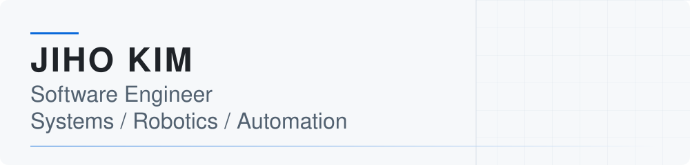

<picture>
  <source media="(prefers-color-scheme: dark)" srcset="assets/profile-header-dark.svg">
  <source media="(prefers-color-scheme: light)" srcset="assets/profile-header-light.svg">
  
</picture>

# 김지호 / Jiho Kim

**Soongsil University · Computer Science** · GPA **4.26 / 4.5** 
**ROBOTIS Software Intern** · Expected Graduation **Feb 2027** 
Open to New Grad Software Engineering opportunities.

[Tech Blog](https://jihodo.tistory.com) · [Problem Solving](https://velog.io/@rlawlgh) · [Solved.ac](https://solved.ac/profile/jihooo7)

## About

운영체제와 Linux 시스템 프로그래밍을 기반으로, 로봇 소프트웨어와 시스템 통합에서 여러 구성요소가 맞닿는 문제를 다룹니다. 
복잡한 시스템에서 software의 success signal과 실제 결과를 분리해 측정하고, 데이터·제어·통신·좌표계의 경계를 추적하며 원인을 좁힙니다. 
Systems, Robotics, Automation을 중심으로 Backend / Platform까지 관심 영역을 넓혀가고 있습니다.

## Experience

### ROBOTIS · Software Intern

**Planning Team** · 2026.06.23–2026.12.21 (종료 예정)

- 공개 VLA 모델의 simulation evaluation 및 physical robot deployment를 경험하며, command vs measured state의 timing / target error를 분석합니다.
- RGB-D perception, calibration, coordinate transform에서 repeatability·bias·accuracy를 구분해 오류를 추적합니다.
- ROS 2 / Linux / container / device communication 환경에서 system integration과 runtime debugging을 수행합니다.
- software 성공 응답과 실제 장치 상태·물리 결과를 별도로 검증합니다.

## Selected Work

<table>
<tr>
<td width="50%" valign="top">
<h3><a href="https://github.com/rlawlgh0813/vla-robotics-lab">VLA Robotics Lab</a></h3>

<strong>Robot Learning / Perception</strong> 개인 학습·실험 / 공개 포트폴리오 재구성. LIBERO 5-model evaluation · RGB-D pose public experiment.

<strong>9/9 detection · 0.68 mm repeatability · bias +7.0 → +0.2 mm</strong> 고정 조건 검출 · 반복 측정: 3D 1σ, 50 frames.

Raw results · validation scripts · limitations 카메라 좌표계 측정; 절대 로봇 좌표 정확도 검증 아님.

<code>Python</code> · <code>RGB-D / OpenCV</code> · <code>VLA</code>

</td>
<td width="50%" valign="top">
<h3><a href="https://github.com/MacGyvBot/macgyvbot">MacGyvBot</a></h3>

<strong>Robot Software / UI</strong> 자연어 기반 로봇팔 공구 전달 · 5인 팀 프로젝트. <strong>내 기여:</strong> STT → rule parser → local LLM command pipeline, PyQt operator UI. Typed ROS interface, task cancel/status, handoff retry/fallback recovery에 기여했습니다.

<strong>Selected PRs:</strong> <a href="https://github.com/MacGyvBot/macgyvbot/pull/14">#14</a> · <a href="https://github.com/MacGyvBot/macgyvbot/pull/159">#159</a> · <a href="https://github.com/MacGyvBot/macgyvbot/pull/210">#210</a>

<code>Python</code> · <code>ROS 2</code> · <code>PyQt</code> · <code>Local LLM</code>

</td>
</tr>
<tr>
<td width="50%" valign="top">
<h3><a href="https://github.com/rlawlgh0813/operating-systems">Operating Systems</a></h3>

<strong>Kernel / Memory / Filesystem</strong> xv6 기반 운영체제 수업 프로젝트. Stride scheduler 구현과 CPU-share 검증, memory / COW 일관성을 다뤘습니다.

<strong>구현 근거:</strong> filesystem snapshot 생성·복원·삭제, block-level COW / refcount.

<code>C</code> · <code>xv6</code> · <code>QEMU</code>

</td>
<td width="50%" valign="top">
<h3><a href="https://github.com/rlawlgh0813/algolog">AlgoLog</a></h3>

<strong>Backend / Authentication</strong> Personal Backend MVP · Paused 알고리즘 풀이 기록 도메인과 JWT / authorization을 구현했습니다.

<strong>구현 근거:</strong> Spring Security, Flyway, Docker Compose, OpenAPI, smoke test / Gradle CI.

<code>Java</code> · <code>Spring Boot / JPA</code> · <code>MySQL</code>

</td>
</tr>
</table>

## Technical Foundation / Skills

- **Languages:** C · C++ · Python · Java
- **Robotics & Perception:** ROS 2 · OpenCV · RealSense · MoveIt
- **Systems & Infra:** Linux · Docker · Kubernetes · GitHub Actions
- **Backend:** Spring Boot · JPA · Spring Security · MySQL

## More Work

- **[Linux System Programming](https://github.com/rlawlgh0813/linux-system-programming)** — 수업 프로젝트: Custom shell · daemon/signal lifecycle · ext2 raw image parser
- **[Robotics Practice](https://github.com/rlawlgh0813/robotics-practice)** — 수업·실습: ROS 2 · ros2_control · MoveIt · RealSense · Isaac Sim
- **[Kubernetes Cloud Practice](https://github.com/rlawlgh0813/kubernetes-cloud-practice)** — 수업·실습: Workloads · networking · configuration · storage
- **[Algorithm Problem Solving](https://github.com/rlawlgh0813/algorithm-problem-solving)** — C++ · Graph · DP · Tree/LCA · Geometry

## Education / Awards & Certifications

**숭실대학교 컴퓨터학부 · Soongsil University, Computer Science** 
2021.03 입학–2027.02 졸업 예정 · **GPA 4.26 / 4.5**

- **2026 SCON 은상 · Silver Award**
- **정보처리기사** · 2026
- **SQLD** · 2025
- **TOPCIT Level 3** · 466/1000
